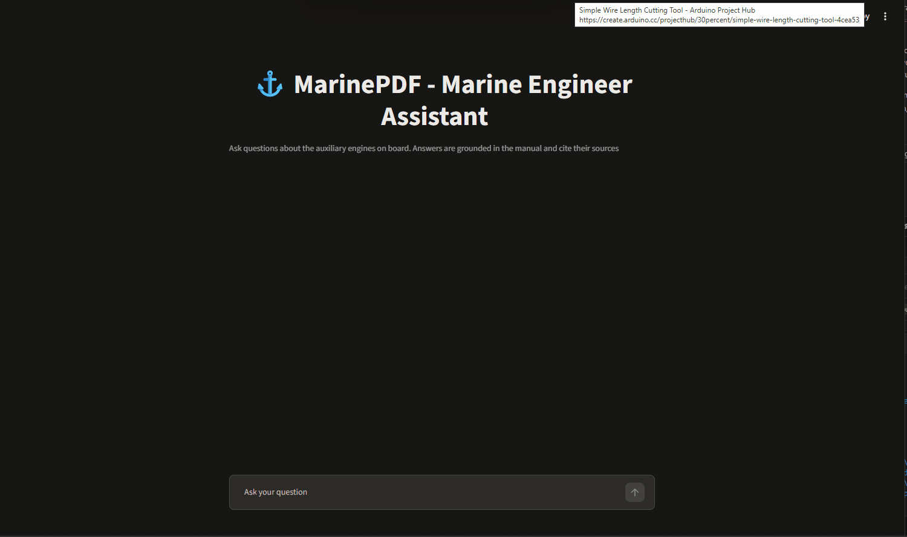
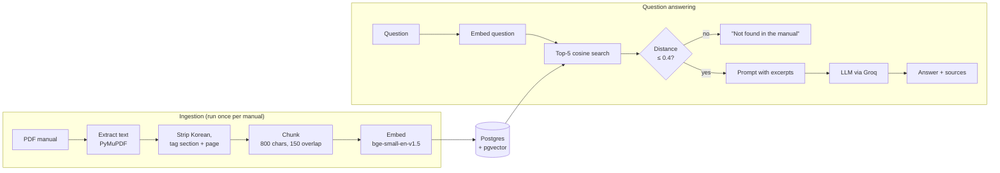

# ⚓ MarinePDF 

A RAG assistant that answers troubleshooting, maintenance and spare-parts questions from a marine diesel generator manual (Hyundai HiMSEN H21/32), citing the section and page for every answer.



## The problem

When a generator alarm goes off at sea, the duty engineer is racing against time. The answer is somewhere in the engine maker's instruction book, which runs to hundreds of pages across several volumes, laid out in two columns of Korean and English. Finding the right procedure, clearance or tightening pressure means flipping through sections by hand, and every minute spent searching is a minute not spent on the actual troubleshooting or maintenance.

MarinePDF turns the manual into something you can ask in plain English. It finds the relevant passages, writes a step-by-step answer based only on them, and tells you which section and page to open to check it. If the manual doesn't cover the question, it says so instead of guessing.

## How it works



1. **Ingestion.** The PDF is read page by page. Korean text is removed, and each page is tagged with the section code and title from its header (for example `G09500 Hydraulic Screw Tightenings`). Pages are split into overlapping chunks, embedded, and stored in Postgres with pgvector. The 382-page manual becomes 677 chunks.
2. **Retrieval.** The question is embedded with the same model and the five closest chunks are fetched by cosine distance. Chunks that are too far away (distance above 0.4) are dropped.
3. **Generation.** If nothing relevant is left, the API answers "I could not find this in the manual." without calling the LLM. Otherwise the remaining chunks go into a prompt that tells the model to use only these excerpts, answer in numbered steps and cite section and page.
4. **Interface.** A FastAPI backend serves `/ask` and `/health`. A Streamlit chat UI calls the API and shows the answer with the cited excerpts underneath.

## Tech stack

| Layer | Tool | Why |
|---|---|---|
| PDF parsing | PyMuPDF | Fast, and keeps the line order of the page header, which is where the section code and title are read from. |
| Embeddings | sentence-transformers, `BAAI/bge-small-en-v1.5` | Free, runs locally on a CPU, small (384 dimensions, ~130 MB) and strong at retrieval for its size. |
| Vector store | PostgreSQL 16 + pgvector | One database for both the vectors and their metadata (section, page). No separate vector service to run, and plain SQL for filtering. |
| ORM / config | SQLAlchemy 2.0, pydantic-settings | Typed models for the schema. Settings come from `.env`, so the code is the same on a laptop and in Docker. |
| LLM | Groq API, `qwen/qwen3.8-27b` | Free tier, very fast responses, and no GPU needed. Running a local model with Ollama was too slow on the target hardware. The provider sits behind an `LLMClient` interface, so it can be swapped. |
| Backend | FastAPI | Request validation from Pydantic schemas, automatic `/docs` page, and dependency injection that makes the endpoints easy to test with fakes. |
| Frontend | Streamlit | A working chat UI in about 60 lines of Python. The UI only talks to the API over HTTP, so it could be replaced by any other frontend. |
| Tests | pytest | 17 tests covering parsing, chunking, prompt building, the RAG service and the API endpoints. The database, embedder and LLM are replaced with fakes, so the suite runs in seconds without Docker or an API key. |
| Deployment | Docker Compose | `docker compose up` starts the database, API and UI together. The embedding model is baked into the API image, so startup needs no download. |

## Quick start

**Prerequisites:** [Docker Desktop](https://www.docker.com/products/docker-desktop/) and a free [Groq API key](https://console.groq.com/keys).

> The manual itself is not included in this repository because it is copyrighted by the engine maker. Use your own copy, or any other engine manual (see [Bring your own manual](#bring-your-own-manual)).

1. Clone the repository and create your `.env`:

   ```bash
   git clone https://github.com/<your-username>/MarinePDF.git
   cd MarinePDF
   cp .env.example .env
   ```

   Open `.env` and set `GROQ_API_KEY`. The other values work as they are.

2. Put the PDF in a `data/` folder:

   ```
   data/IM_2 DIESEL GENERATOR ENGINE VOL I_Vol.1.pdf
   ```

3. Build and start everything:

   ```bash
   docker compose up --build
   ```

   The first build takes several minutes (PyTorch and the embedding model are downloaded). Later builds are cached.

4. Ingest the manual (once). In a second terminal:

   ```bash
   docker compose exec api python -m backend.ingestion.ingest "data/IM_2 DIESEL GENERATOR ENGINE VOL I_Vol.1.pdf"
   ```

   This prints `Ingested 677 chunks from ...`. The data is kept in a Docker volume, so you don't need to repeat it after a restart.

5. Open the app:

   | Service | URL |
   |---|---|
   | Chat UI | http://localhost:8501 |
   | API docs | http://localhost:8001/docs |
   | Health check | http://localhost:8001/health |

### Running without Docker (development)

Requires Python 3.11.

```bash
python -m venv .venv
.venv\Scripts\activate          # Windows; on macOS/Linux: source .venv/bin/activate
pip install -r requirements.txt

docker compose up -d db         # only the database
python -m backend.ingestion.ingest "data/IM_2 DIESEL GENERATOR ENGINE VOL I_Vol.1.pdf"

uvicorn backend.api.main:app --reload --port 8001
streamlit run frontend/app.py   # in another terminal
```

Run the tests with `pytest`. They don't need the database, the model or an API key.

### Bring your own manual

Any text-based PDF manual can be ingested with the same command. Section codes and titles are read from the page header in the HiMSEN layout (`Section No.` followed by a code like `G09500`). For a manual with a different layout, ingestion still works, but sources will show page numbers without section names until `extract_section` in [`backend/ingestion/pdf_reader.py`](backend/ingestion/pdf_reader.py) is adapted. If you change `EMBEDDING_MODEL`, also update the model name in [`backend/Dockerfile`](backend/Dockerfile) and re-ingest.
## Design decisions

- **Korean text is stripped, not translated.** The manual is printed in two columns, Korean and English. Korean characters are removed with a Unicode-range regex, and lines that end up with no letters or digits are dropped. Removing whole Korean lines was not an option because 486 of them also carry English text.
- **Chunks never cross a page.** Every chunk keeps one page number and one section, so a source citation always points to a single page you can open.
- **The 0.4 cutoff comes from measurement.** Questions the manual covers came back with cosine distances of 0.17 to 0.28; unrelated questions started at 0.47. Anything above 0.4 is treated as "not in the manual", and the LLM is not called at all.
- **The model was picked for faithfulness, not size.** I compared `gpt-oss-120b` and `qwen3.8-27b` on the same questions. Qwen stayed closer to the manual's wording and was faster, so it won.
- **Temperature 0.1.** Maintenance steps should come out the same way every time.

## Roadmap

- **More machines:** main engine, purifiers, boilers and compressors, each with its own manual, and filtering by machine.
- **Tables:** clearances, pressures and temperature limits are in tables, which plain text extraction misses today.
- **Better troubleshooting:** going from an alarm or a symptom to the likely causes and the right checks.
- **Learning from experience:** adding past defect reports and engineers' notes next to the manual, so answers include what actually worked on board.

The long-term goal is a complete marine engineer assistant for the engine room.
